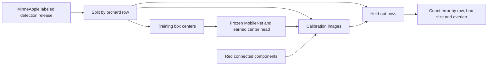
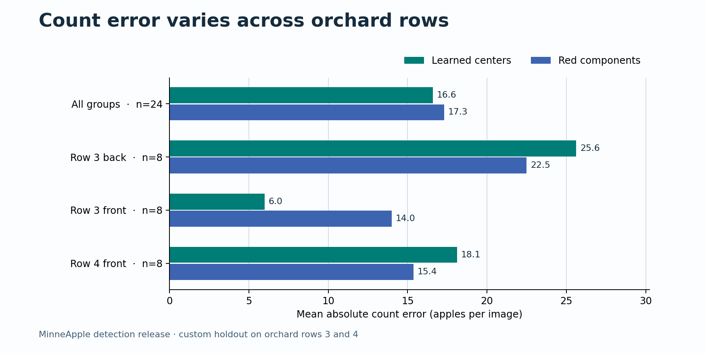
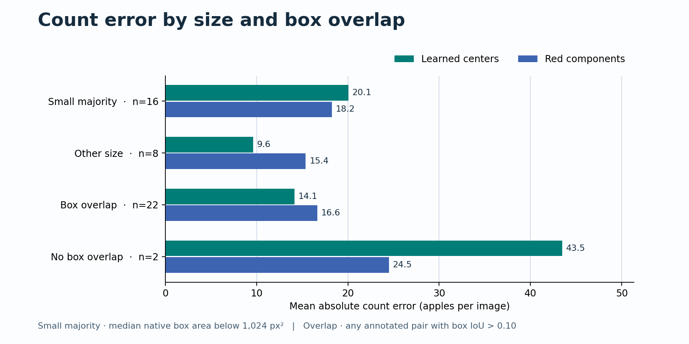
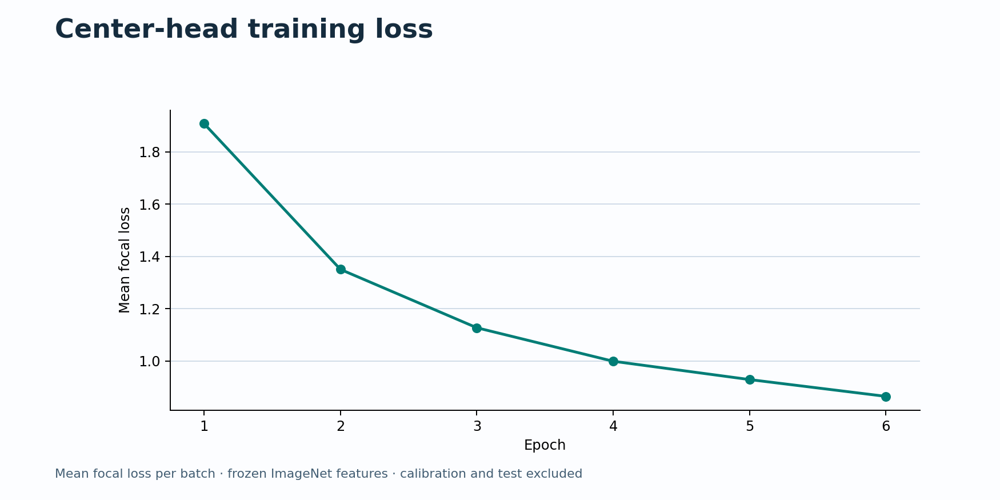

# Orchard Fruit Counting Robustness

Estimate visible apple counts from RGB orchard photographs and measure where the estimates fail. The benchmark compares a lightweight learned center detector with a red connected-component baseline on MinneApple.

## Data and split

The project uses MinneApple by Nicolai Häni, Pravakar Roy and Volkan Isler. The University of Minnesota released the detection annotations with the September 2022 test-data update. Consult the [dataset record](https://doi.org/10.13020/8ecp-3r13) and [CC BY-NC-SA 3.0 US](https://creativecommons.org/licenses/by-nc-sa/3.0/us/) terms. Images, masks, COCO annotations and trained weights stay outside the repository. The published figures summarize counts and errors.

The row-holdout experiment uses a deterministic subset of that labeled detection release. The row numbers come from the source filenames. Row 1 supplies 30 training images, row 2 supplies 12 calibration images and rows 3 and 4 supply 24 evaluation images. Counts are balanced by the available sides within each split. This is a custom row-holdout evaluation. The original benchmark uses a separate designated training archive.

## Pipeline



The learned detector uses early ImageNet-pretrained MobileNet V3 Small features, a stride-four heatmap head and focal loss. Candidates are local heatmap maxima after 3×3 suppression. The baseline counts eight-connected regions above a red-color margin and a minimum region area. A grid search selects the score threshold and color parameters on the calibration row. The evaluation compares MAE, RMSE and bias, measured in apples per image. Source-size cohorts use median box area, and the overlap cohort uses any annotated box pair with IoU above 0.10.

## Visual results

On 24 held-out images with 1,253 annotated apples, the learned detector achieved 16.58 MAE and 21.87 RMSE. Red components achieved 17.29 MAE and 20.24 RMSE. Both methods underestimated counts on average. The per-cohort results are descriptive at this sample size. [Metrics](reports/minneapple-metrics.json)







## Reproduce

Install Python 3.13 and run at the repository root. Acquisition requests only the selected ZIP members. It validates the total archive length and ZIP CRC for each member fetched. The full archive checksum applies when using the complete download.

```powershell
python -m pip install torch==2.9.1 torchvision==0.24.1 --index-url https://download.pytorch.org/whl/cpu
python -m pip install -r requirements.txt
python prepare_row_holdout.py
python count_apples.py --subset runs/row-holdout --out runs/benchmark
python plot_results.py --metrics runs/benchmark/metrics.json
python -m unittest discover -s tests -v
```

For the official train and detection-test split, download the complete [detection archive](https://conservancy.umn.edu/server/api/core/bitstreams/3ef26f04-6467-469b-9857-f443ffa1bb61/content) into `data/raw/detection.tar.gz`. Then run `python fetch_test_labels.py` and `python prepare.py`. Use `--subset runs/subset` and a separate output directory for that experiment.

The images come from one orchard. A box-overlap flag captures an observable geometry of the annotations, and the count includes visible fruit. The stride-four target can merge two annotated centers in the same cell. Different acquisition conditions would need a separate evaluation.
